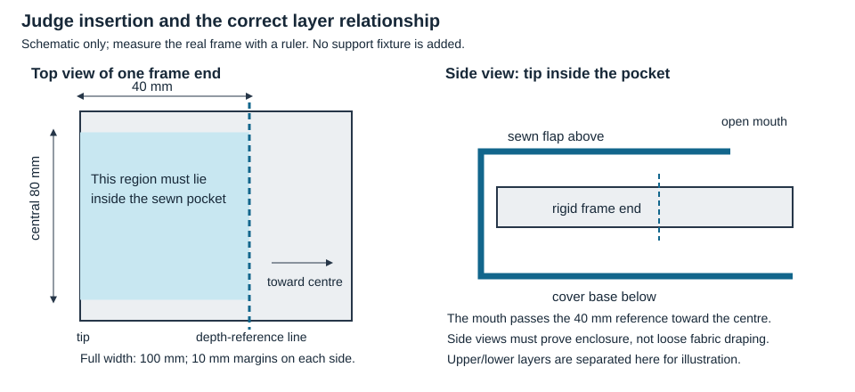

# Real-trial scoring: pocket mop cover

This is the **real-trial-v1 judging procedure for the handle-held-v2 endpoint**.
It uses ordinary video, close-up photographs, a ruler, printed scales/angle
references and a timer. It requires no mesh data, strain sensor, contact-force
sensor or substep contact measurement. It has been checked against the existing
simulation evidence and worked examples, **not tested on physical hardware**.
The recorded simulation scores remain in [SCORING_REVISION.md](SCORING_REVISION.md).

## Outcome rubric

Judge the final demonstrated state, not the highest partial state seen earlier.

| Score | Observable conditions |
|---|---|
| 0.0 | Neither pocket qualifies at the finish, or a trial-wide disqualification below is established. |
| 0.25 | One correctly oriented pocket encloses at least 40 mm of its frame end across the central 80 mm of the 100 mm head width, continuously for the final two seconds with the entire textile ungripped. |
| 0.5 | Both pockets meet that condition; the complete retention demonstration is not achieved. |
| 1.0 | Both pockets qualify and remain seated; the frame stays open, locked and within 3 degrees of flat; the same hand supports only the handle through the lift, translation, return and two-second hold below. |

The full retention sequence requires the **lowest part of the cloth**, not just
the frame, to stay at least 100 mm above the tabletop. From the initial lifted
position, translate the head at least 100 mm horizontally, return within 10 mm
of that initial position and hold there for at least two seconds. The other
entire arm must stay at least 20 mm from the whole assembly. There must be no
contact supporting the cloth, head, wings, connector or latch, and no textile
pinching by the holding hand. Finish holding the handle; set-down and release
are not required. Once both pocket holds qualify, start a fresh motion proof.

Loss of a pocket's seating or any textile grasp resets the affected pocket hold
(the textile-grasp exclusion applies to both pockets). Loss of flatness or lock,
pocket loss, extra support, a hand change, another-arm clearance below 20 mm, or
cloth height below 100 mm resets the entire retention sequence. Return drift
beyond 10 mm before the hold completes resets the hold timer. A recovered run
may complete a fresh sequence within its budget. Interrupted support alone does
not erase otherwise valid final pocket partial credit.

A trial-wide disqualification gives **0.0**, regardless of earlier progress:
new visible fabric tears or through-holes; a separated stitched seam; a detached
pocket flap; a broken frame or latch; an unauthorized attachment, fixture or
human intervention during execution; or exceeding the execution budget.
Ordinary wrinkles, temporary stretching, nap movement and pre-existing documented
surface wear are not damage. A new seam opening means formerly sewn edges have
visibly separated or detached, rather than the normal open pocket mouth.
The assessment does not try to infer transient strain from appearance.

If required evidence is missing, occluded in every view, or too imprecise to
resolve a threshold, record **unscorable (score: null)** with the missing item.
Do not equate an unmeasured condition with failure or with success. A clearly
proved trial-wide disqualification can still establish zero. Otherwise resolve
the measurement from another synchronized view or obtain a new properly recorded
trial; do not award an arbitrary lower score to conceal missing evidence.

## Prepare the evidence before the clock starts

1. Lay out the separate frame and cover as declared in task.json. Inspect and
   photograph both fabric faces, both pocket flaps, their sewn boundaries and
   the frame/latch. Include a ruler and document any pre-existing wear. Do not
   start with a torn cover, separated seam, broken latch or added restraint.
2. Measure 40 mm inward from each frame tip and mark a thin depth-reference line
   on the upper surface and visible side edges. Mark the central 80 mm width
   span (10 mm in from each side of this 100 mm head). Capture ruler photographs
   before covering the marks. Use thin removable ink; no tape ridge, clip,
   spacer or mark that changes gripping, friction or pocket fit.
3. Mark a fixed reference point at the rigid head/bridge centre. Prepare
   millimetre scales and a printed 3-degree reference for side-on views. Record
   a known ruler length at the height and plane of each measurement, including
   the planned lift plane. References stay outside the contact/work volume.
   They never prop up, constrain or touch the assembly during execution.
4. Record a wide continuous view of both complete arms, the handle, head, cover
   and tabletop, plus synchronized side/oblique views that reveal both pocket
   mouths, the holding fingers and the lowest cloth. Use at least 20 frames/s
   with timestamps. Choose resolution/distance so the ruler divisions, pocket
   edges and sewn boundaries can actually be resolved; nominal resolution alone
   is not proof. Close-up stills supplement, not replace, the continuous record.
5. Verify camera coverage and calibration before starting. A scale on the table
   alone cannot measure an elevated object's height or horizontal displacement
   without correcting perspective. Use a view perpendicular to the measurement
   plane and references at the same depth. If the head changes depth, use the
   appropriate calibrated view or scale; do not silently reuse a pixel/mm ratio.

## Run and finish

Start the real-trial clock at the first robot/teleoperation command. The limit is
120 seconds of elapsed execution at 20 Hz, at most 2,400 target intervals. Holds
and inference waits count in a physical trial; its dynamics cannot be paused.
Initial preparation and post-trial inspection are outside that clock. For the
existing simulations, use the recorded 2,400-action/120-s simulated-time limit;
physics pauses during inference, as already declared. Do not substitute their
inference wall time for simulated execution time.

Record the declared finish timestamp within the budget. It must follow the
successful hold for full credit, or the final two-second pocket holds for partial
credit. Evaluate the state at that timestamp. Keep the assembly in that state
long enough for close-up photographs; time after the finish earns no credit.
Record the transition to inspection so later camera/inspector handling cannot be
mistaken for robot execution or a successful hold.

## Measure and inspect

**Pocket seating and orientation.** Use the pre-trial reference photographs and
close-up top and side views. The mouth of each sewn pocket must extend inward
beyond the 40 mm line across the entire central 80 mm band, without a central
fold or exposed interval breaking that coverage. Check the two band boundaries
and the interior, not only one corner. The closed end points toward the frame
tip and the open mouth toward the head centre. Side views must show the tip
between the cover base below and the sewn flap above. Covering a depth mark with
loose draped fabric, or concealing it with an inside-out flap, does not establish
insertion. If the layer relationship or depth-reference position cannot be
resolved, the pocket measurement is unknown. Use video timestamps to verify that
the entire textile is ungripped and the seating persists for two full seconds.

**Cloth and mechanism integrity.** First photograph the untouched finished
assembly and pocket mouths. Then an inspector may carefully remove the cover
on camera solely to inspect both fabric faces and all stitched boundaries,
comparing them to the pre-trial photographs. This cannot establish missing
seating, reseat a pocket, repair damage or add retention time. Photograph any
new tear, hole, seam separation, detached flap or frame/latch break with a ruler.
Do not stretch or pull the cloth to test an inferred strain limit. If handling
during inspection creates damage and its origin cannot be distinguished, mark
the integrity assessment unknown rather than attributing it to the robot.

**Flatness and locking.** Use the side view normal to the folding axis and the
printed angle reference to measure each wing against the central head plane;
both must stay within 3 degrees. Whole-head tilt is not wing folding. The latch
must be in its engaged configuration and the wings must stay open through the
unsupported retention motion. A frame pressed flat by a finger does not pass.

**Handle-only support.** Across the whole motion proof, the same hand visibly
grips the handle. The holding hand must not pinch the textile or brace the head,
connector or latch. The cloth and non-handle frame parts remain clear of both
arms and all external supports. Use the wide and close views together, including
when one view is occluded. Sustained lift, the visible grip and absence of another
load path establish support; no force measurement or finger-to-handle gap in
millimetres is requested. Treat any visible contact by another robot part or external object with the
cloth or a non-handle frame part during the proof as extra support, even if its
load is unknown. An ambiguous contact cannot establish full credit.

**Other-arm clearance.** Check the entire other arm, including forearm and wrist,
against the frame, handle and cloth throughout the proof. Use calibrated views
and a 20 mm reference; a clearly calibrated projected separation of at least
20 mm is a conservative way to establish separation, provided scale and depth
are valid for both objects. For an easier measurement, park the other arm outside
a premeasured work envelope plus a 20 mm margin and verify that the assembly
stays within that envelope and the arm stays outside it. Markings are visual
references only. Checking just the non-holding gripper is insufficient.

**Lift, translation, return and timing.** Use the lowest cloth edge in the
calibrated side views for the 100 mm height check. Track the same head-centre
reference point in the calibrated horizontal view. Record its initial lifted
position, maximum horizontal distance from that point and return distance.
Measure actual horizontal distances, not image-axis motion distorted by depth.
The return must remain within a 10 mm radius for two seconds, with all other
retention conditions maintained. Use the difference between video timestamps;
a count of frames without their time span is insufficient.

**Measurement uncertainty.** Record conservative lower/upper measurement bounds
from ruler readability, perspective and occlusion. A minimum passes only when
its lower bound meets the threshold; a maximum passes only when its upper bound
meets the threshold. An interval straddling a threshold is unknown. For example,
39–42 mm insertion is unknown, 42–44 mm passes, and 35–38 mm fails. Reposition an
inspection camera while preserving the finished state if that resolves seating;
it cannot repair missing continuous evidence of the earlier motion.

Complete [REAL_TRIAL_WORKSHEET.md](REAL_TRIAL_WORKSHEET.md), attaching image/frame
references and times for each judgment. A second reviewer should be able to
reproduce the score from the evidence and worksheet alone.

## Simulation-only checks and their real-trial counterparts

The existing Python scorers assess **simulation**. Their `score`, `success` and
`invalid_reasons` contract remains unchanged. A numerical violation can still
invalidate simulated evidence; it is not a measurement required of a real trial.
There is no switch to disable physics qualification or grant credit to invalid
simulated contact. Report the domain when discussing a result.

| Simulation measurement or validity check | Real-trial outcome/evidence |
|---|---|
| Maximum native textile edge strain >20% | Before/after inspection for visible tears, holes, seam separation or detached pockets. No transient strain limit is applied to real cloth. |
| Numerical interpenetration >1 mm, native seam gap >1 mm | Visible integrity and valid assembly; no contact/support that defeats the task. Do not estimate penetration or microscopic seam gaps from video. |
| Nonfinite states, mesh consistency and every physics substep | Complete continuous recordings and inspection. There are no real-trial mesh/substep quantities. |
| Holding fingers within 2 mm of the handle | Visible sustained handle grip by the same hand and motion of the freely supported assembly. |
| Non-handle frame ≥2 mm from all robot links; cloth/grasp proximity tests | No visible non-handle contact or cloth pinching/support during the proof, established by multiple views. No real-trial 2 mm margin is imposed. |
| Other entire arm ≥20 mm away | The same measurable 20 mm real-trial condition using scales or a verified clear work envelope. |
| Volume-containment samples and surface normals for pocket seating | Correct layer relationship and orientation, measured 40 mm insertion across the central 80 mm, maintained for two seconds. |
| Native wing angles, cloth height and head poses | Side-on angle reference, lowest-cloth height and calibrated head-point displacement. The 3-degree/100 mm/100 mm/10 mm/2 s outcome thresholds are shared. |
| Unexpected constraints or diagnostic initialization | Inspect the declared starting setup and reject extra attachments, restraints or interventions. |

The real trial does not require proving absence of every microscopic transient
contact. Judges assess the recorded observable support, seating and retention
conditions. The stricter numerical guards remain additional simulation assurance.
